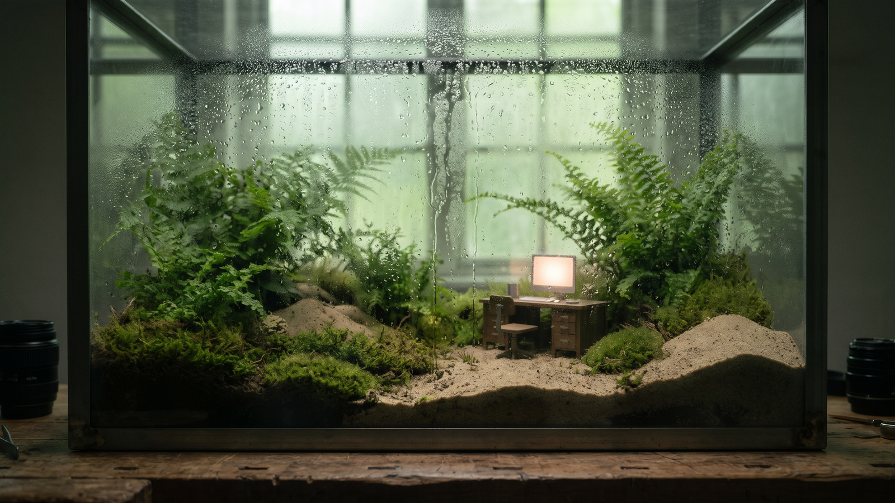
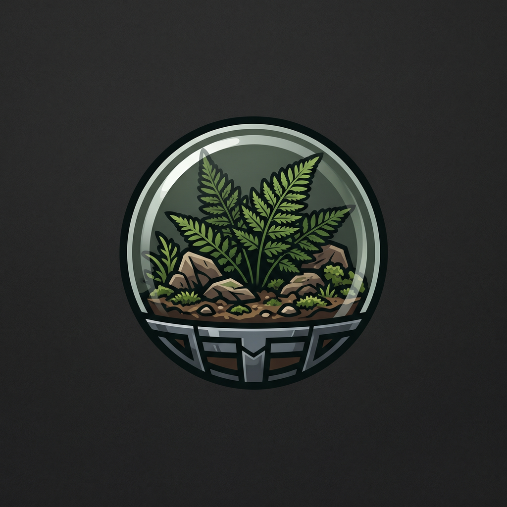
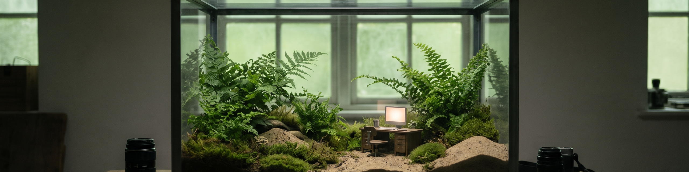
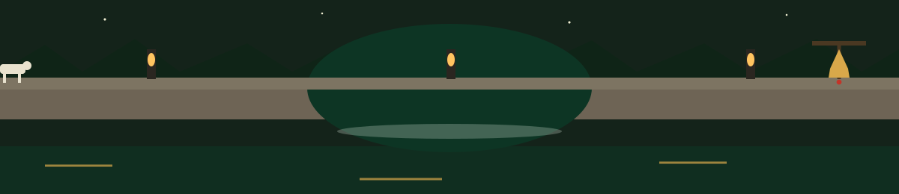

# Sandboxed-Brave-Browser

A custom sandboxed brave browser.

`sandbox.sh` runs Brave inside Firejail. It needs both `firejail` and
`brave` on PATH; if either is missing it says so and exits instead of
launching Brave without the sandbox. Any arguments are passed through to
Brave: `./sandbox.sh https://example.com`

> **Toll keeper's margin note:** if firejail or brave is missing, the script says so and exits instead of launching Brave without the sandbox.

> **Toll keeper's margin note:** arguments pass through unchanged, quoted as `"$@"`, so an argument with spaces stays one argument.
